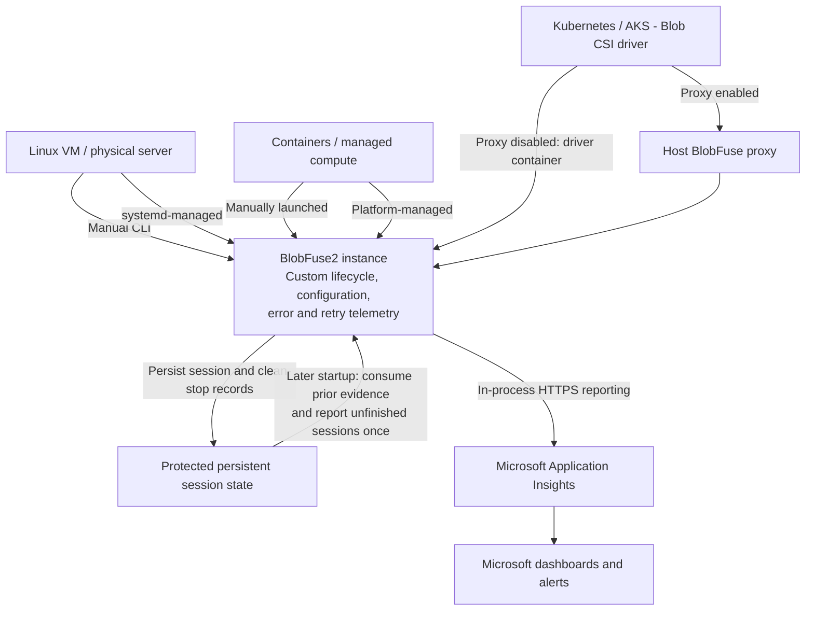

# BlobFuse2 Microsoft Telemetry Design

Status: Proposed design; not a description of currently implemented behavior.

Implementation decisions confirmed on 5 November 2026:

- Default-enabled policy with config/CLI/environment opt-out; any disable wins.
- Opt-out deletes retained telemetry. The compiled destination currently points
  to the personal test resource and must be replaced before main/release.
- Five-minute snapshots with jitter; five-second request/total flush budgets.
- 32-KiB events with split snapshots; eight active sends and no waiting queue.
- Private state under the working directory, seven-day/1-MiB retention limits.
- Exact retry-backoff duration and confirmed exhaustion are deferred.
- BlobFuse-only integration; no CSI manifest changes.

Additional revisions:

- Send once and continue: each event, including later-start recovery, has one
  asynchronous send opportunity. Failures never stop future reporting.
  Excess work is dropped at eight active sends; no delivery retries or retry
  spool remain. Retained lifecycle evidence is consumed before dispatch,
  accepting loss if a process dies between consumption and transmission.
- Payload simplification removes observation-source, shutdown-outcome, HTTP/FUSE
  scope labels, counter-encoding/retry-scope labels and backoff/exhaustion
  availability flags. Session identity replaces the separate attempt ID in
  payloads, daemon handoff and checkpoints. Attribute-cache
  enablement is derived from the effective pipeline instead of sent separately.
  Existing retained records remain replayable with retired properties stripped.
- Clean exit requires explicit successful pipeline teardown, not just a nil
  error passed by deferred cleanup.
- Retention, recovery and opt-out are isolated per canonical logical mount and
  local namespace/deployment scope. The ingestion destination is common to all
  mounts; there is no per-destination partition.
- Destination selection follows AzCopy: a compiled production default and only
  `BLOBFUSE_TELEMETRY_CONNECTION_STRING` as a runtime override. The compiled
  value targets TEST until the production resource is approved and must not
  ship unchanged. Destination YAML/CLI settings and their
  configuration-specific tests are removed; the old `telemetry-test.env` file
  remains removed. Smoke testing requires an explicit environment destination.
- The default directory name remains `microsoft-telemetry`; its proposed rename
  is deferred.

See [implementation configuration and limitations](microsoft-telemetry.md).
The proposal below retains the original target coverage; the deferred SDK
metrics must not be interpreted as implemented.

## 1. Goal and decisions

Phase 1 provides Microsoft-facing visibility into mount lifecycle, effective
configuration, errors, and retries across BlobFuse deployment environments.

The agreed approach is:

- Custom structured lifecycle events and bounded in-memory counters, without
  OpenTelemetry.
- Direct asynchronous HTTPS reporting from BlobFuse to Microsoft-owned
  Application Insights.
- Protected local session state and terminal evidence for recovery on
  a later startup.
- No change to the default BlobFuse process-launch architecture.
- No new supervisor, systemd termination helper, or independent reporting task.

Collection must be separate from the Microsoft-specific encoder and reporter
so a later phase can reuse approved observations for customer monitoring.
Customer exporters and customer monitoring configuration are not implemented
in Phase 1.

Telemetry is best-effort. Its failure must not fail customer I/O, prevent a
mount, or indefinitely delay unmounting.

## 2. Scope

### Lifecycle

- Mount attempts, successes, and failures with categorized reasons.
- Time-to-mount and time-to-failure.
- Clean termination and later discovery of unfinished sessions.
- Measured uptime while alive and final or last-known uptime.
- Recovery correlation between sessions where local identity survives.
- Effective configuration context and fingerprint at mount.

### Errors and retries

- HTTP response distribution, including 403, 404, 409, 412, 429, 500, and 503.
- Successful and other responses for rate denominators.
- Retry attempts, retried requests, and confirmed retry exhaustion.
- HTTP 429 rate and actual retry-backoff duration.
- Timeouts, connection resets, TLS failures, and DNS failures.
- Final FUSE errno by operation, including EIO, ENOSPC, EACCES, and ESTALE.

### Non-goals

- Uploading all diagnostic logs, raw error messages, or configuration files.
- Read/write latency histograms, throughput, cache-efficiency metrics, or
  CPU/memory monitoring.
- Customer-facing metrics endpoints or exporters.
- An ingestion gateway or an additional analytics streaming tier.
- Automatic installation of supervisors or automatic process restart.
- Guaranteed crash/OOM attribution, immediate post-death delivery, or lossless
  reporting.

## 3. Architecture



Each deployment has its own BlobFuse instance. The shared block represents
common implementation, not a centralized BlobFuse process.

Arrows show launch relationships, local state handoffs, or explicitly labeled
network delivery. They do not show customer file-data traffic. Storage access
continues through the existing FUSE, component, and Azure Storage paths.

The CSI host proxy is an existing mounting component, not a newly introduced
telemetry supervisor. Its survival does not automatically provide per-mount
termination evidence. CSI volumes using NFS do not run BlobFuse and are outside
this design.

## 4. Internal components

| Component | Responsibility |
|---|---|
| Lifecycle recorder | Create typed attempt, result, clean-stop, and recovery records |
| Counter store | Maintain bounded, concurrency-safe cumulative measurements |
| Snapshot worker | Collect counter values, sequence, and elapsed uptime periodically |
| Session-state store | Persist session identity, clean-stop evidence and later-start recovery observations |
| Microsoft event encoder | Map approved internal records to Application Insights properties and numeric measurements |
| HTTPS reporter | One-shot asynchronous sends, eight-send concurrency cap, deadlines and bounded shutdown waiting |

Measurement hooks must not construct Application Insights envelopes or perform
network requests. Existing diagnostic logging remains separate.

## 5. Identity and event contract

Use random identifiers, not identifiers derived from mount paths, account names,
credentials, or configuration contents.

| Field | Purpose |
|---|---|
| `schema_version` | Version of the approved record contract |
| `event_id` | Stable identity preserved across delivery retries |
| `mount_session_id` | Mount startup and prospective mounted lifetime, shared across daemon startup parent/child |
| `sequence_number` | Order of snapshots within a session |
| `event_time_utc` | Observation timestamp |
| `elapsed_uptime_seconds` | Monotonic elapsed mounted duration when available |
| `config_fingerprint` | Cohort identity for approved effective configuration |

A new session is not automatically an unexpected restart. A
manually repeated command can also produce a new session.

### Event types

| Event | Trigger and contents |
|---|---|
| `blobfuse.mount.attempted` | Actual mount request begins; available version and identity |
| `blobfuse.mount.result` | Confirmed readiness or definitive failure; duration, stage, category, approved configuration |
| `blobfuse.mount.snapshot` | Periodic cumulative error/retry counters and uptime |
| `blobfuse.mount.stopped` | Completed graceful teardown; final known uptime and outcome |
| `blobfuse.mount.recovery` | Later discovery of an unfinished previous session; last-known state and explicit uncertainty |

The proposed snapshot interval is five minutes with jitter. It is an initial
design parameter, not a measured optimum. Lifecycle events are dispatched promptly.

## 6. Mount lifecycle

Instrument configuration parsing, mount-path validation, pipeline construction,
authentication/storage initialization, daemon startup, and FUSE readiness.

Create an early in-memory recorder, but transmit or retain Microsoft telemetry
only when the effective collection policy permits it. Malformed configuration
must not become a reason to bypass opt-out.

Coordinate the startup parent and daemon child under one attempt identity and
one logical result. Use structured startup communication rather than uploading
stderr or trace files. Foreground execution owns both startup and runtime
reporting.

Define time-to-mount as attempt start to confirmed readiness after required
initialization. Measure end-to-end daemon startup in the parent; do not assume
serialized timestamps retain Go's monotonic clock information. A startup wait
timeout means readiness was not observed by the deadline, not necessarily that
the child definitively failed.

### Failure categories

| Category | Required evidence |
|---|---|
| `fuse_permission` | Confirmed FUSE/helper permission rejection, including applicable fuse.conf restrictions |
| `authentication` | Credential acquisition or validated authentication failure |
| `authorization` | Access denied with evidence distinguishing it from authentication |
| `container_not_found` | Container/filesystem-level absence, not merely an object 404 |
| `dns_resolution` | Typed resolver error |
| `private_endpoint_resolution` | Endpoint context and evidence supporting the more specific diagnosis |
| `mount_directory_not_empty` | Mount-path validation rejection |
| `pipeline_config_conflict` | Pipeline/component validation rejection |
| `libfuse_incompatible` | Detected runtime/API incompatibility |
| `other` / `unknown` | Failure without sufficient specific evidence |

Include a bounded startup stage. Assign categories at the point where errors
are understood; do not parse arbitrary diagnostic strings centrally.
Compatibility warnings that disable optional features are not mount failures.
Failures before the binary can execute, such as a dynamic-loader failure,
cannot be reported by in-process instrumentation.

## 7. Configuration fingerprint

Canonicalize and hash only approved effective fields, and transmit those fields
alongside the fingerprint so analysts can explain configuration differences.

| Field | Representation |
|---|---|
| Pipeline | Ordered effective component names, including file_cache, block_cache, stream, or xload where applicable |
| Auth mode | Bounded enum including key, SAS, MSI, SPN, and other supported modes |
| FUSE | Build target, runtime libfuse version, negotiated kernel protocol where available |
| Platform | Normalized distro/version and kernel release |
| BlobFuse | Product version |
| allow-other | Effective boolean |
| Attribute cache | Enabled state and effective component TTL |
| Kernel attribute caching | Separate effective FUSE/kernel timeout |

Use the resolved pipeline rather than inferring it from a single flag.
Unavailable startup fields remain unavailable. A fingerprint is neither a
customer identity nor a privacy mechanism; hashing raw configuration is not
permitted.

## 8. Error and retry aggregation

Use fixed counters or bounded category tables. Do not allocate a per-request
telemetry record or create arbitrary attribute combinations on the I/O path.

| Measurement | Definition |
|---|---|
| HTTP responses | Observed responses by status |
| HTTP attempts | Observable transport attempts, including no-response failures |
| Retry attempts | Additional SDK attempts after the first |
| Retried requests | SDK request scopes performing at least one retry |
| Retry exhausted | Terminal request failure specifically due to retry-budget exhaustion |
| Backoff duration | Actual accumulated retry-wait time |
| Transport failures | Typed DNS, TLS, timeout, reset, cancellation, and other categories |
| SDK terminal failures | Request failures after retry processing |
| Filesystem outcomes | Completed operations and final returned errno by operation |

Separate logical storage operations, SDK request/retry scopes, HTTP attempts,
and FUSE operations. They have different counts and must not be added together.
Separate initialization and runtime observations.

Compute the HTTP 429 rate from 429 responses divided by all HTTP responses.
Keep confirmed storage-side 503 throttling classifications separate; not every
503 has an established throttling cause.

Classify errors using typed inspection. Capture response-body failures as a
separate observation scope where appropriate, since receiving response headers
does not establish successful streamed-body completion.

### Retry instrumentation dependency

The pinned SDK retry loop controls delay calculation, Retry-After handling,
actual waiting, and terminal stop decisions. Ordinary per-call/per-retry hooks
do not expose all of this reliably.

Accurate backoff and retry-exhaustion metrics require a structured SDK observer
or equivalent supported integration. Prefer an upstream extension while
preserving SDK retry behavior. An inter-attempt gap is not exact backoff, and
reaching an attempt count does not itself prove retry exhaustion. Until the
integration exists, mark these measurements unavailable rather than emitting
misleading zeros or claiming full coverage.

### FUSE errno boundary

Record errno after final mapping, including early-return paths and native C
cached-I/O errors. Do not infer it from HTTP status. Retain the operation because
some callback results, such as release results, are not propagated as ordinary
application syscall errors.

Native instrumentation must avoid a new C-to-Go transition for every I/O.

### Snapshot semantics

Use cumulative values within a session. The backend derives differences between
ordered snapshots and handles duplicate/out-of-order arrival. Never sum
cumulative snapshots as if they were disjoint windows.

A later snapshot can bridge a missing report while counters survive. It cannot
recover unsaved counters after process death. Reading independent atomic
counters introduces small collection skew; snapshots are not guaranteed
transactionally consistent across all fields.

## 9. Clean shutdown and recovery

### Clean teardown

1. Complete graceful teardown and determine its outcome.
   Explicitly mark completion only after all pipeline components stop
   successfully. Deferred cleanup during a panic must not imply clean exit.
2. Atomically persist the terminal record and completed-shutdown state.
3. Validate and durably consume retained terminal evidence before dispatch.
4. Attempt one asynchronous delivery with a short, bounded shutdown budget.
5. Exit without waiting indefinitely for telemetry.

Before a terminal event's send opportunity, validate its session, durably retire
that session, and only then remove any legacy pending copy. Failure/conflict
prevents sending, with diagnosed evidence retained for a later consumption
attempt. Network failure, expiry or concurrency admission failure does not
recreate consumed state. A crash after consumption can lose the event.

Separate the fact of clean teardown from successful delivery. Failure to send
the clean-stop event must not cause later recovery to label the session unclean.
Perform reporting through normal shutdown code, not low-level signal handlers.

### Later-start recovery

1. Scan approved prior state accessible to this deployment.
2. Verify that an unfinished session is not still active.
3. Consume any eligible legacy pending lifecycle records for one-shot dispatch.
4. For a dead session without completed-shutdown evidence, create one stable
   recovery observation classified as `unclean_unknown`.
5. Report last-known uptime and state without inventing an exact death time.

A PID alone is insufficient because of PID reuse. Liveness verification must
account for process start identity, host boot identity, PID namespaces, and
concurrent mounts. If evidence is insufficient, defer classification. Recovery
claiming and pending-record processing must be concurrency-safe.

Do not classify unfinished state as confirmed crash, OOM, or automatic restart.
It can also result from forced kill, reboot, power loss, or a failed state write.
Use any opaque local mount-slot mapping only where continuity is reliable;
do not transmit the mount path or its hash.

If no suitable later startup occurs or state is lost, recovery reporting does
not occur. A successful application-pod restart does not necessarily restart
the CSI-managed BlobFuse process.

## 10. Persistent state

A proposed system-wide layout is:

```text
/var/lib/blobfuse2/telemetry/
    .scope-key
    mount-<opaque-local-scope>/
        session-<session-id>.json
        event-<event-id>.json  # Legacy files only; no new delivery spool.
```

The root path above is conceptual. The current default is
`<default-working-dir>/microsoft-telemetry`. Choose a deployment-appropriate directory
outside the mounted container and customer data cache. Per-user execution needs
an appropriately protected user-owned location; multiple users must not gain
access to each other's state.

Use restricted ownership/permissions, safe file handling, atomic publication,
and synchronization appropriate to the durability guarantee. Enforce
create-if-absent semantics or equivalent synchronization for logical terminal
records; an overwriting rename alone does not provide that guarantee.

Bound record size, total bytes, count, retention, and recovery work per startup.
Limits apply per mount store; they are not an aggregate host quota. Scope
identity is derived locally from canonical path and mount namespace, or a
deployment-provided stable label. It is not uploaded. Legacy unscoped records
cannot be attributed safely and remain untouched with a diagnostic.
Normal persistence reserves 64 KiB within the one-MiB limit for recovery updates.
Recovery dispatches terminal events directly from their session checkpoints,
without creating a second event file. Legacy pending events are collected before
updates so one capacity or write failure cannot prevent unrelated delivery from
freeing space. Dead-session handoff counters can be compacted during conversion;
no pending lifecycle evidence is silently evicted to make room.
Retain enough completion/delivery state to prevent recreating an already
handled event. Persistence errors produce bounded diagnostics and degraded
telemetry, not customer I/O failure.

For containers, explicitly provision state that survives the relevant container
replacement. Node-backed state usually does not survive node deletion.
Cross-node recovery and shared-state coordination are not provided in Phase 1.

For CSI, verify the deployed proxy/direct execution path, effective state
location, permissions, and future-start discovery. Existing host-backed CSI
directories do not automatically provision this telemetry state.

## 11. HTTPS reporting and backend

Encode approved lifecycle records and snapshots as packed Application Insights
custom events. Report directly to the Microsoft-owned ingestion endpoint.
No customer storage credentials or customer monitoring resource are required.

The reporter must:

- Allow up to eight active send goroutines; drop excess work without waiting.
- Apply five-second request deadlines and bounded shutdown waiting.
- Handle partial ingestion and permanent failures explicitly.
- Do not retry failed sends or honor Retry-After for delivery scheduling.
- Continue reporting future events after any delivery failure.
- Keep reporting traffic separate from instrumented storage traffic.
- Emit bounded local diagnostics for dropped records and delivery failures.

Snapshots and ordinary lifecycle sends are not spooled. Session checkpoints and
terminal evidence support later-start recovery, not retrying failed reports.
Consumed evidence is not restored after a rejected, failed or cancelled send.

Application Insights does not become idempotent merely because a custom
event_id is present. One-shot dispatch does not guarantee delivery or ordering.
KQL analysis must deduplicate logical records where needed, correlate
recovery evidence, and retain unresolved attempts rather than treating missing
results as failures.

Use workspace-based queries and dashboards for lifecycle outcomes, configuration
cohorts, error/retry rates, observed uptime, recovery observations, and telemetry
health. BlobFuse-specific validation occurs after ingestion. Define retention,
ingestion limits, volume alerts, and budget monitoring before rollout; budget
alerts alone do not stop ingestion.

## 12. Privacy and security

- Approve the implemented default-enabled collection policy before rollout.
  Without a configured destination collection remains inactive.
- Honor policy for collection, persistence, recovery, and reporting. Define how
  disabling collection handles already pending records.
- Never transmit credentials, SAS tokens, connection strings, paths, account or
  container names, raw error messages, or arbitrary configuration.
- Allow-list fields and bound categories at collection and encoding.
- Require HTTPS for production and define a controlled destination policy.
- Treat public-client submissions as untrusted; an instrumentation key identifies
  a destination, not an authenticated BlobFuse installation.
- Protect local files against unauthorized modification, unsafe links, and
  unbounded accumulation.

## 13. Implementation surfaces

These are investigation/integration targets, not claims that the new telemetry
already exists:

| Surface | Proposed integration |
|---|---|
| CLI execution and cmd/mount.go | Attempt ownership, validation failures, parent/child coordination |
| internal/pipeline.go | Structured component startup failures |
| component/libfuse/ | Readiness, final errno, native error paths, teardown |
| component/azstorage/utils.go and policies.go | Shared Blob/ADLS SDK and transport instrumentation |
| SDK retry integration | Actual wait and terminal-retry evidence |
| New internal telemetry module | Typed records, counters, state management, encoder, reporter |

Existing stats-manager/health-monitor records may contain paths. Do not upload
them wholesale or require the customer to run bfusemon.

## 14. Validation and open decisions

Validate foreground and daemon startup without double-counting; each failure
category; successful retries versus exhaustion; cancellation during backoff;
typed network errors; native and Go errno paths; clean shutdown with failed
delivery; lost acknowledgements; concurrent recovery; PID reuse and namespace
ambiguity; read-only/full state storage; container replacement; and state loss.

Benchmark telemetry enabled versus disabled, especially high-concurrency cached
I/O. No fixed overhead or memory claim is established by this design.

Decisions required before implementation:

- Production collection policy and pending-record behavior on opt-out.
- SDK retry-observer integration.
- Supported state paths and permissions per deployment.
- CSI proxy/direct integration and recovery discovery.
- Exact schema, concurrency/persistence limits, intervals, and shutdown budgets.
- Runtime libfuse identification and reliable failure categorization.
- Backend destination, retention, capacity, and operational ownership.

The design intentionally trades immediate abnormal-termination reporting for a
smaller, portable implementation that leaves BlobFuse's launch architecture
unchanged. Confirmed crash/OOM and supervisor restart attribution remain deferred.
